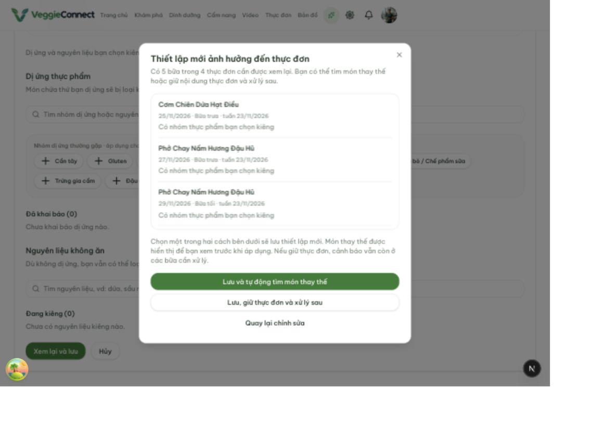

# Direct food preferences — implementation and verification

**Version:** 1.0
**Updated:** 2026-11-19
**Status:** IMPLEMENTED; API/browser verified; authenticated native UI validation pending environment availability.

## Delivered behavior

Backend, web and Expo mobile use four independent daily allowances: eggs, dairy, honey and five pungent ingredients. Profile diet type, religion/tradition and practice-calendar setup are removed. Meat, fish/seafood and other animal groups stay prohibited. Allergies and explicit exclusions override allowances. Reviewed composition traverses descendants; unknown classification is not treated as permission. Canonical pungent members are hành, hẹ, tỏi, kiệu, hưng cừ; boaro is not automatically part of that group. Classification retains review/source/license/version provenance independently of allergens.

Before profile save, both clients preview affected current/future meals and offer automatic replacement or keeping the plan with warnings. Saving succeeds independently of repair. Warnings come from current backend assessment and survive refresh; keeping never overrides confirmation constraints. Replacement preview is read-only, includes nutrition/shopping changes, and requires explicit apply. Clients process more than 20 selected plans in visible batches rather than dropping IDs. Each plan applies atomically with individual outcomes, idempotency and stale profile/plan/catalog guards. Only affected meals from the current local date onward change; past and compatible meals remain. Pantry and purchases remain unchanged.

Confirmed programs are protected from direct repair. A linked DRAFT copies selected future plans; draft snapshots reflect the copied item IDs and later repair. Explicit confirmation records replacement lineage without rewriting source content. Snapshot refresh cannot overwrite confirmed programs, stale plan snapshots cannot be confirmed, and user/catalog locks serialize critical writes against profile/catalog changes.

## Verification results

| Area | Result and scope |
| --- | --- |
| MongoDB | Isolated MongoDB 7 replica set, `vegan_diet_qa`, provisioned all 112 collections/validators/indexes and seeded successfully. Default project database was not reset or migrated. |
| Backend | `npm run lint`, `npm run typecheck`, `npm run build`, `npm run openapi:generate`, existing `meal-plans:acceptance` and `meal-analysis:acceptance` all pass after final transaction guards. No new backend test infrastructure. |
| Contract | Generated and served OpenAPI checked; final frontend `npm run sync:swagger -- ../backend/openapi.json`: 198 endpoints, 43 groups, 164 schemas. |
| Core live checks | All 16 allowance combinations; baseline prohibited groups; exact pungent membership; soy milk versus dairy; nested egg; allergy/exclusion precedence; reviewed/unknown classification; metadata invalidation; no-op revision; concurrent profile save conflict. |
| Plan live HTTP | Draft impact preview; saved-and-kept warnings; readonly repair preview; selective replacement; 20 other plans unchanged; repeat apply idempotency; stale profile 409. |
| Edge live checks | Historical plan classification; no candidates; mixed FAILED/UNCHANGED outcomes with content preserved; unknown classification distinct from violations; catalog change rejects old proposal; expired proposal 409; deleted custom meal reports source unavailable. |
| Program live HTTP | Confirmed source warnings; direct repair blocked; linked DRAFT; copied future plans/new snapshot item IDs; selective repair; refreshed draft snapshot; explicit confirmation; source replacement lineage and content preserved. |
| Transaction guards | Direct temporary checks: confirmed snapshot cannot be refreshed, stale snapshot cannot overwrite a newer plan, confirmation rejects stale snapshot. Temporary guard fixture removed. |
| Web | Typecheck, changed-source lint (zero warnings), production build (47 pages) pass. Final batch fix: 119 test files / 922 tests pass and typecheck/scoped lint pass; build was already passed before this component/helper-only fix. |
| Browser | Authenticated real API flow: profile four toggles → impact dialog with both actions → keep → saved summary and persistent list warnings after navigation → selected-plan repair preview → apply → only repaired plan warning removed. Narrow viewport document 341px/dialog 309px, no horizontal overflow. |
| Mobile | Typecheck, lint and 166 tests pass; iOS bundle export succeeds. Native app guest/login gate rendered with no runtime errors. No dependency manifest/lock changes. |
| Working tree | `git diff --check` passes. Unrelated diagrams and `.DS_Store` files excluded from the work. Publication is tracked by the feature branch/PR history; no deployment performed. |

Temporary scripts under `/tmp` exercised the isolated QA database; they are not a new repository test suite. Scenario plans remain only in that disposable database for inspection. The API and browser sessions used local QA ports rather than the default database. Classifications, profile state and temporary mutations used by edge checks were restored where applicable.

## Native validation limits

Authenticated native iOS/Android end-to-end and UI-driven web↔native checks were **not run**. The installed Xcode lacks the full Simulator.app GUI/native interaction driver; Android adb/emulator tooling is unavailable. Native guest rendering and Expo export do not substitute for those checks. The same API contract, DTO/model mappers, compatibility/repair logic and batching have mobile tests, but native authenticated release QA remains a separate check when that environment is available.

## Running against a development database

This is a deliberate dev-only schema/contract break, with no legacy profile/calendar/client adapter. Configure a disposable MongoDB replica-set database, then run from `backend/`:

```sh
npm run prisma:generate
npm run prisma:push
npm run seed
npm run dev
```

Schema provisioning/seed is required in each developer's environment before using the new code. Existing old dev records may be discarded/recreated; no production migration or data-preservation claim is made. Food-data provenance requirements remain applicable.

## Evidence



Related: [approved plan](DIRECT_FOOD_PREFERENCES_PLAN.md), [impact behavior](DIET_PROFILE_MEAL_PLAN_IMPACT.md), [integration contract](../frontend/docs/BACKEND_INTEGRATION.md), [mobile notes](../mobile/docs/DIETARY_PREFERENCES.md).

## Follow-up: Device Hub authentication recovery — 2026-11-19

The initial native-driver limitation was overcome by controlling the Device Hub application through the native computer-use surface. Mobile had no persistent `.env`; the old open bundle did not use the active backend ngrok tunnel, and services had been stopped after QA. After restarting the default dev backend/MongoDB, login200 but profile500 exposed the old development schema. Per the approved disposable-dev-data scope, the local default database was archived (600 permissions) to /tmp/vegan-support-before-food-preferences-20261119.archive.gz, recreated with the112-collection schema and reseeded. This supersedes the earlier statement that the default database was untouched; that statement describes the original implementation QA only.

Mobile now loads the active HTTPS ngrok backend URL from its ignored `.env`. Restarted Metro with tunnel/clear; Device Hub opened that fresh Expo URL. Public HTTP login/profile for Member and organization Contributor both200 with four allowances; native iPhone16/iOS26.1 QA login also succeeds and opens the four-switch screen and authenticated profile. The temporary QA account was logged out and deleted; the user's expert@example.com login form is restored. Network/timeout login errors have distinct messages. Mobile typecheck/lint/166tests and diffcheck pass. No backend code/auth-contract change. Services are left running for continued testing.

Authenticated iOS login/profile is now verified. Full native dietary impact/repair/keep E2E, Android and cross-client UI scenarios remain unverified; this follow-up does not claim those gates passed.
