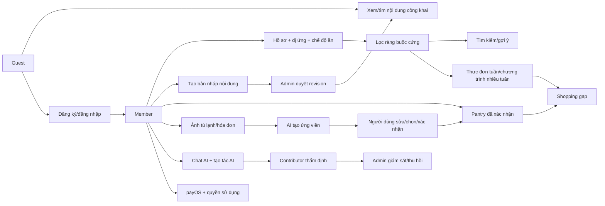

# 1. Sơ đồ nghiệp vụ và ranh giới hệ thống

## Bài nói mở đầu 60 giây

“Vegan Support Application hỗ trợ người ăn chay quản lý chế độ ăn, tìm và chia sẻ nội dung, lập thực đơn, quản lý nguyên liệu và nhận gợi ý từ AI. Hệ thống có web Next.js, mobile Expo và một backend Express dùng MongoDB qua Prisma. Backend quyết định quyền, ràng buộc dị ứng/ăn chay, phiên bản dữ liệu, quota và thời điểm ghi vào Pantry. AI đưa ra đề xuất có mức không chắc chắn; nội dung công khai cần Admin duyệt và kết quả quét ảnh cần người dùng xác nhận.”

Nguồn: [SRS](../SRS.md), [Implementation Plan](../IMPLEMENTATION_PLAN.md), [backend app composition](../../backend/src/app.ts), [Prisma schema](../../backend/prisma/schema.prisma).

## Sơ đồ tổng thể



## Ai có quyền gì?

| Tác nhân | Việc chính | Ranh giới dễ bị hỏi |
|---|---|---|
| Guest | Xem/tìm nội dung đã xuất bản, dùng chat giới hạn, đăng ký | Không quản lý dữ liệu cá nhân hoặc nội dung riêng của người khác. |
| Member | Hồ sơ/diet, tạo nội dung, cộng đồng, plan, Pantry, chat, scan khi capability phù hợp | Tạo nội dung chỉ tạo draft; nộp đơn Contributor không tự cấp quyền. |
| Contributor đã được Admin duyệt | Quyền Member + thẩm định tạo tác AI đủ điều kiện | Mọi Contributor có cùng quyền; không được tự thẩm định tạo tác của mình; không có quyền duyệt xuất bản cuối cùng. |
| Admin | Duyệt nội dung/Contributor, quản trị catalog, food data, moderation, AI và một số chính sách | Quyết định phải có lý do/audit; signal AI hay report không là phán quyết cuối. |

Nguồn: [SRS §3](../SRS.md), [Contributor state machine](../../backend/src/modules/contributors/contributor-application.state-machine.ts), [content publication policy](../../backend/src/modules/content/content-publication.policy.ts).

## Sáu nguyên tắc phải thuộc

1. Dị ứng, nguyên liệu loại trừ, diet pattern và tradition rule đang bật là **ràng buộc cứng ở backend**. Tìm kiếm/plan lọc trước, cá nhân hóa chỉ xếp hạng phần còn hợp lệ.
2. Quyền Contributor đến từ **quyết định Admin và role backend**, không từ ý định đăng ký hay `approvalBasis`.
3. Tạo nội dung → submit revision → Admin duyệt → mới công khai; sửa bản đã duyệt tạo draft revision mới, bản cũ còn public cho đến khi bản mới được duyệt.
4. Ảnh/AI tạo **candidate**. Chỉ thao tác confirm rõ ràng của user mới ghi Pantry. Không suy diễn độ tươi/an toàn thực phẩm từ ảnh.
5. Dinh dưỡng chuẩn có source/license/version; estimate phải nói rõ assumptions/coverage/uncertainty. Thiếu dữ liệu là “chưa biết”, không phải số 0.
6. Browser redirect từ payOS không cấp quyền lợi. Chỉ settlement phía server đã xác minh mới cộng gói, một lần.

Nguồn: [Implementation Plan §5](../IMPLEMENTATION_PLAN.md), [meal plan service](../../backend/src/modules/meal-plans/meal-plan.service.ts), [billing service](../../backend/src/modules/billing/billing.service.ts).

## Ba sơ đồ trạng thái nên vẽ trên bảng khi bị hỏi

```text
Nội dung: DRAFT → PENDING_REVIEW → PUBLISHED hoặc REJECTED
          PUBLISHED --sửa--> draft revision mới; revision cũ vẫn công khai

Media:    RESERVED → COMMITTED / RELEASED / EXPIRED

Scan:     QUEUED → PROCESSING → READY hoặc PARTIAL_FAILED/FAILED
          → user sửa/chọn → CONFIRMED; có thể CANCEL/RETRY theo state
```

Tên state cụ thể trong API có thể khác sơ đồ rút gọn của [Implementation Plan §7](../IMPLEMENTATION_PLAN.md). Khi hỏi enum/HTTP code chính xác, đọc [OpenAPI](../../backend/openapi.json) và service tương ứng. Đừng gộp “job xử lý xong” với “Pantry đã cập nhật”.
