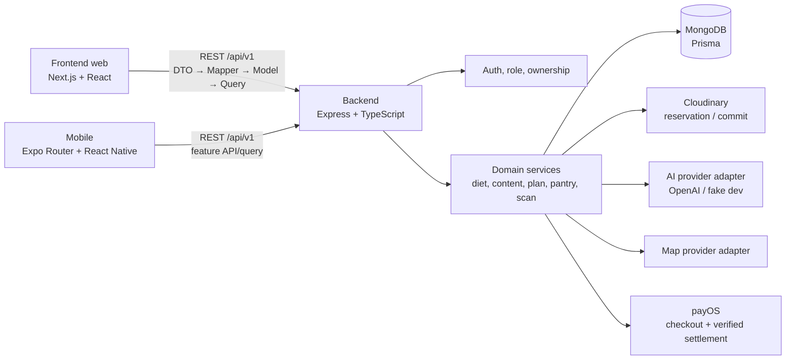

# Bổ sung tài liệu ôn bảo vệ — cập nhật 21/10/2026

Tài liệu này bổ sung các thay đổi mới vào kế hoạch ôn bảo vệ. Nó đối chiếu source hiện tại với SRS, Implementation Plan, Backend Integration và các ghi nhận triển khai. Dùng tài liệu chuẩn ở repo làm căn cứ khi trạng thái khác nhau.

## Trạng thái snapshot cần nhớ

- `HEAD`: `a022917` trên nhánh `dev`, cập nhật đến 19/10/2026.
- Working tree hiện có thay đổi frontend chưa commit ở API Catalog, Backend Integration, PROGRESS/WORK-LOG và hai feature quét ảnh. Các thay đổi này không được xem là trạng thái đã merge.
- Phase 21 (nhận diện ảnh tủ lạnh), Phase 22 (bóc tách hóa đơn) và Phase 27 (hardening/release gate) vẫn được ghi `IN_PROGRESS`. Nguyên nhân chính là chưa xác nhận độ chính xác/behavior trên bộ ảnh thực tế đại diện với OpenAI.
- Các file này được đọc và đối chiếu tĩnh. Lượt bổ sung này không chạy lại typecheck, test, build, HTTP hoặc browser acceptance. WORK-LOG ghi kết quả kiểm tra của nhóm triển khai; đó không phải kết quả được xác minh lại trong lượt này.

## Bản đồ hệ thống để trình bày



Trong phần trình bày, nói rõ backend là nơi thực thi quyền sở hữu, ràng buộc ăn kiêng/dị ứng, quota, state transition và mutation Pantry. Web/mobile hiển thị trạng thái và thu nhận xác nhận; chúng không phải nguồn quyết định an toàn hoặc phân quyền.

**Cảnh báo về tài liệu cũ:** `backend/docs/BACKEND_FEATURES_AND_WORKFLOWS.md` ghi cập nhật 08/10 và còn nói PostgreSQL/168 operations. Hãy lấy persistence hiện tại từ `backend/prisma/schema.prisma` và [MONGODB_MIGRATION.md](../../backend/docs/MONGODB_MIGRATION.md); lấy API readiness từ [BACKEND_INTEGRATION.md](../../frontend/docs/BACKEND_INTEGRATION.md), không đọc con số/trạng thái cũ trong workflow overview như runtime truth.

## Bổ sung theo 5 buổi ôn

### Buổi 1 — Kiến trúc và ranh giới trách nhiệm

Ôn thêm khác biệt giữa web và mobile: hai client gọi cùng backend nhưng có router, component system, state/query và luồng upload riêng. Frontend web tuân theo tầng DTO/Model/Mapper/API/Query; mobile cũng có feature modules, mapper, query và upload workflow. Backend chia router → controller → service → repository/provider; MongoDB là database hiện tại, còn migration PostgreSQL cũ được giữ làm lịch sử.

**Câu hỏi dễ gặp:** “Nếu frontend gửi món không phù hợp dị ứng thì sao?”

**Cách trả lời:** frontend có thể lọc để UX nhanh, nhưng backend là nơi áp allergy, exclusions, diet pattern và tradition đang bật. Ranking/recommendation chỉ xếp hạng các món còn hợp lệ; không được đưa món bị loại trở lại.

**Câu hỏi dễ gặp:** “AI nhận diện xong có tự thêm nguyên liệu vào kho không?”

**Cách trả lời:** không. AI tạo candidate và mức độ không chắc chắn; người dùng sửa/chọn rồi xác nhận. Confirm là ranh giới duy nhất cập nhật Pantry.

### Buổi 2 — Meal plan và dinh dưỡng sau cập nhật

- Meal plan tuần có 7 ngày × 3 bữa = 21 slot. Backend trả `targetCalories`; frontend không tự thay mục tiêu này bằng một công thức TDEE riêng.
- Slot hỗ trợ 4 số đa lượng: protein, fiber, fat, carbohydrate. Khi đổi món hoặc thêm món thủ công, backend tính lại theo servings và trả dữ liệu slot mới.
- So sánh ngưỡng dùng số chưa làm tròn để tránh cảnh báo sai do làm tròn hiển thị.
- Cảnh báo chất xơ rất cao trên frontend hiện dùng `FIBER_UPPER_CAUTION_GRAMS = 70 g/ngày`; đây là cảnh báo thận trọng và lời khuyên uống đủ nước, không phải giới hạn y khoa hay hard constraint backend. Không gọi mức tối thiểu 14g/1000 kcal là upper limit.
- Meal-plan analysis là phân tích có version/fingerprint; nếu đầu vào đổi, kết quả cũ có thể stale. Trả lời theo status/API hiện tại thay vì nói cảnh báo là chẩn đoán.

**Tình huống hỏi:** “Một ngày có 1 slot thiếu macro hoặc API trả null?”

Nói rằng UI phải giữ trạng thái chưa có dữ liệu riêng với số 0; không suy luận null thành 0. Nếu analysis stale, tải lại/phân tích theo contract; không trình bày kết quả cũ như kết quả mới.

### Buổi 3 — Nhận diện ảnh tủ lạnh và hóa đơn

Luồng chung:

```text
chọn ảnh → validate → reserve quota → upload Cloudinary → commit MediaAsset
→ tạo/cập nhật job async → polling → sửa/chọn/reject candidate
→ user confirm → backend transaction cập nhật Pantry
```

**Nhận diện tủ lạnh:** tối đa 6 ảnh/job. Backend có thể gộp cùng nguyên liệu qua nhiều ảnh, giữ evidence theo ảnh và uncertainty note. Nếu số lượng giữa ảnh khác nhau thì không cộng dồn như thể có hai lần mua; hệ thống giữ đề xuất phù hợp hơn và yêu cầu người dùng kiểm tra. Candidate đã bị user sửa/từ chối không được ghi đè khi merge ảnh mới.

**Hóa đơn:** tối đa 4 ảnh/job. Gộp dòng lặp qua các ảnh khác nhau để tránh nhân đôi số lượng/tiền; các dòng giống nhau trong cùng một ảnh vẫn được giữ vì hóa đơn có thể có hai dòng mua riêng. Giữ raw line text/uncertainty để người dùng đối chiếu. Dòng không đủ quantity/unit không được đưa vào confirm.

**Retry và thêm ảnh:** retry xử lý ảnh thất bại; add-images gắn ảnh mới vào job còn có thể review và phân tích ảnh mới. Hai thao tác phải bảo toàn edit/rejection của user. Retry/add-images không tự cập nhật Pantry.

**Câu trả lời mẫu về dedupe:** “Ảnh trùng nội dung được so bằng ETag của storage provider nếu có. Candidate tủ lạnh được gộp theo canonical ingredient hoặc tên chuẩn hóa; số lượng không cộng vì nhiều ảnh có thể chụp cùng một vật. Hóa đơn dùng text/identity, total và thông tin dòng để gộp giữa ảnh, nhưng giữ dòng lặp trong cùng ảnh. Trường hợp không chắc vẫn được đưa ra cho người dùng xác nhận.”

### Buổi 4 — Lỗi, xung đột và trạng thái chưa sẵn sàng

| Tình huống | Điều hệ thống cần làm | Cách nói khi demo/vấn đáp |
|---|---|---|
| Tải ảnh vượt giới hạn | Client chặn sớm; backend vẫn kiểm tra quota và giới hạn | “UI chỉ là tiện ích; backend kiểm tra lại.” |
| Cùng ảnh được tải hai lần | ETag trùng thì bỏ phân tích lặp; asset đã tạo vẫn cần theo dõi quota/lifecycle | “Dedup xử lý nội dung, không dựa duy nhất vào tên file.” |
| Provider lỗi một phần | Job thể hiện ảnh lỗi/partial; retry ảnh lỗi; không xác nhận dữ liệu sai | “Partial result vẫn cần người dùng rà lại; retry không ghi đè sửa tay.” |
| User sửa trong lúc có kết quả ảnh mới | Chỉ cập nhật proposal chưa bị sửa; giữ user edit/reject và gắn thêm evidence | “Quyết định tường minh của user có ưu tiên hơn kết quả AI.” |
| Confirm khi job chưa sẵn sàng hoặc version cũ | Backend từ chối theo state/version; frontend tải lại trạng thái | “Không gửi confirm mù; version guard ngăn ghi đè.” |
| Upload commit thành công nhưng add-images API lỗi | Asset đã commit có thể đã tính quota; kiểm tra job và trạng thái asset trước khi retry, tránh upload lặp | “Đây là đường lỗi cần acceptance rõ; retry phải dùng operation/idempotency phù hợp.” |
| AI trả kết quả sai hoặc không rõ | Cho sửa/reject; không tự biến thành canonical truth hay Pantry | “AI đưa tín hiệu/ước lượng; người dùng quyết định.” |
| Ảnh có dấu hiệu đồ ăn hỏng | Chỉ ghi quan sát thận trọng; không tuyên bố an toàn/nguy hiểm chắc chắn | “Ứng dụng không thay thế đánh giá an toàn thực phẩm.” |

**Điểm rất quan trọng khi bảo vệ:** khả năng FE gọi được endpoint không đồng nghĩa endpoint `READY`. `BACKEND_INTEGRATION.md` vẫn ghi Phase 21/22 là `IN_PROGRESS` do kiểm chứng ảnh thật chưa hoàn tất; Phase 27 cũng chưa đóng release gate. Vì vậy hãy mô tả add-images là phần đang tích hợp/dev-preview nếu chưa có quyết định readiness mới, và không tuyên bố OpenAI nhận diện ảnh Việt Nam chính xác hoặc production-ready.

### Buổi 5 — Demo, dữ liệu thanh toán và câu hỏi phản biện

- Demo scan nên dùng ảnh test được phép, nói rõ provider đang dùng (fake hay OpenAI), kiểm tra trạng thái consent/configuration và chỉ xác nhận Pantry sau khi người dùng xem candidate.
- Không lấy kết quả fake-provider làm bằng chứng AI thật nhận diện tốt; dữ liệu confirm vẫn có thể ghi vào database development.
- payOS checkout trong môi trường phát triển vẫn có thể chuyển tiền thật. Thiếu merchant credentials thì checkout phải bị tắt, không giả lập thành giao dịch đã thanh toán. Return URL trên browser không cấp quyền lợi; chỉ webhook/query đã xác minh mới settle order.
- Nếu giảng viên yêu cầu scan thật hoặc mua gói thật, trình bày trước phụ thuộc provider/key/chi phí và dùng bằng chứng acceptance có sẵn. Không chạy giao dịch hoặc gọi dịch vụ trả phí bất ngờ trong buổi chấm.
- Có thể trình bày một vòng ngắn: hồ sơ/diet → meal plan → scan candidate → sửa/reject → confirm → kiểm tra Pantry. Nêu riêng error case: stale version/provider partial failure.

## Các thay đổi mới cần bổ sung vào câu chuyện project

1. **Meal plan data sync (17/10):** 21 slot, dữ liệu macro theo slot, ảnh recipe, swap/manual add trả dữ liệu cập nhật. Nói rõ target do backend trả.
2. **Backend scan improvements (17–19/10):** dedupe ảnh theo ETag, merge candidate/dòng lặp, giữ uncertainty/evidence và retry theo ảnh lỗi; Phase 21/22 vẫn còn live-provider acceptance gate.
3. **Frontend scan additions (working tree ngày 21/10):** API/DTO/model/mapper/query, nút thêm ảnh cho hai màn review, cập nhật progress UI và mapper tests. Các file này chưa commit tại snapshot; changelog trên đầu Backend Integration ghi FE integrated `Yes`, trong khi bảng chi tiết vẫn có dòng `No`, và status endpoint là `IN_PROGRESS`. Đây là mâu thuẫn cần giải quyết trước khi trình bày là integration hoàn tất.
4. **Mobile follow-up (14/10):** map fallback có hành động mở provider map/directions; meal plan hiển thị target backend; Pantry giải thích RESTORE; một số chức năng vẫn chặn bởi API/native dependencies. Xem WORK-LOG mobile để phân biệt phần chạy được với phần còn cần native device acceptance.

## Việc cần chốt trước ngày chấm

- Thống nhất một câu trả lời về trạng thái web scan: endpoint `IN_PROGRESS`, FE code có thay đổi local, provider acceptance còn mở. Không gọi là `READY` cho tới khi backend/integration registry cập nhật theo gate.
- So sánh hai API `/images` ở changelog đầu và bảng chi tiết trong `BACKEND_INTEGRATION.md`; hiện `FE integrated` đang lệch `Yes`/`No`.
- Nếu demo dựa trên working tree, chạy lại các gate và kiểm tra HTTP/browser với backend tương ứng; nếu không, demo đúng commit đã chốt. Bản ghi WORK-LOG nói test/build pass nhưng lượt rà này chưa chạy lại.
- Cập nhật hoặc đánh dấu `backend/docs/BACKEND_FEATURES_AND_WORKFLOWS.md` là historical snapshot, vì mô tả PostgreSQL và OpenAPI count không còn khớp runtime hiện tại.
- Rà soát doc review frontend ngày 15/10 trước khi trích các số lint/test/build: số liệu đó là ảnh chụp cũ, chưa kiểm tra lại trên HEAD mới.

## Nguồn đối chiếu chính

- [SRS](../SRS.md), [Implementation Plan](../IMPLEMENTATION_PLAN.md), [Roadmap Phase 2](../ROADMAP_PHASE_2.md).
- [Backend phase status](../../backend/docs/IMPLEMENTATION_PHASES.md), [MongoDB migration](../../backend/docs/MONGODB_MIGRATION.md), [business rules](../../backend/docs/BUSINESS_RULES.md).
- [Backend Integration](../../frontend/docs/BACKEND_INTEGRATION.md), [Frontend Architecture](../../frontend/docs/ARCHITECTURE.md), [Frontend Architecture Review 15/10](../../frontend/docs/FRONTEND_ARCHITECTURE_REVIEW_2026-10-15.md).
- Source: `backend/src/modules/ingredient-recognition/`, `backend/src/modules/receipts/`, `backend/src/common/media/asset-dedup.ts`, `frontend/src/features/ingredient-vision/`, `frontend/src/features/receipt/`, `frontend/src/features/meal-plan/`, `mobile/src/features/`.
